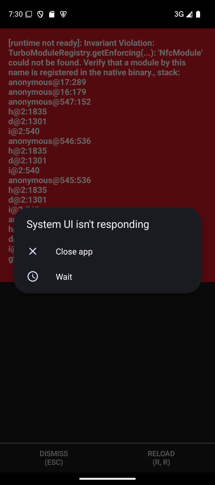

# CSW 434 — Practice Assignment 3: Compass with Turbo Native Modules

- **Student's Full Name:** Hoàng Anh Kiệt
- **Student ID:** `2231200101`
- **Course:** CSW 434 — Advanced Mobile Programming
- **University:** Eastern International University (EIU)

---

## 1. Overview

React Native Android application that uses the **Magnetometer** sensor (`Sensor.TYPE_MAGNETIC_FIELD` + `Sensor.TYPE_ACCELEROMETER`) via a custom **Turbo Native Module** (`CompassModule.kt` & `NativeCompassModule.ts`) to determine the device's orientation relative to North and display the **Screen 1** compass interface.

---

## 2. Emulator Screenshot



---

## 3. Project Structure

```text
CSW434_Lab3_HoangAnhKiet_2231200101/
├── screenshots/
│   └── screen_compass_clean.png
└── Lab3Sensors/
    ├── App.tsx                          # Renders CompassScreen directly
    ├── src/
    │   ├── specs/
    │   │   └── NativeCompassModule.ts   # TurboModule spec for CompassModule
    │   └── screens/
    │       └── CompassScreen.tsx        # Screen 1 Neumorphic Compass UI
    └── android/app/src/main/java/com/lab3sensors/
        ├── MainActivity.kt
        ├── MainApplication.kt           # Registers SensorsPackage
        ├── SensorsPackage.kt            # Provides CompassModule
        └── CompassModule.kt             # Kotlin Turbo Native Module for Magnetometer Compass
```

---

## 4. How to Run

```bash
cd Lab3Sensors
npm install
npm run android
```
