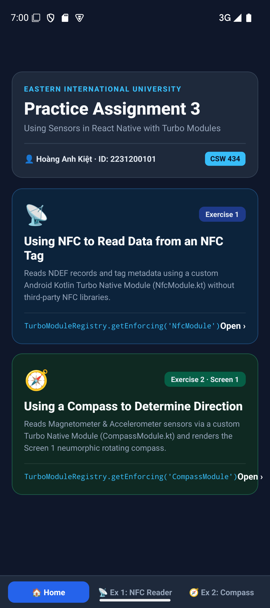
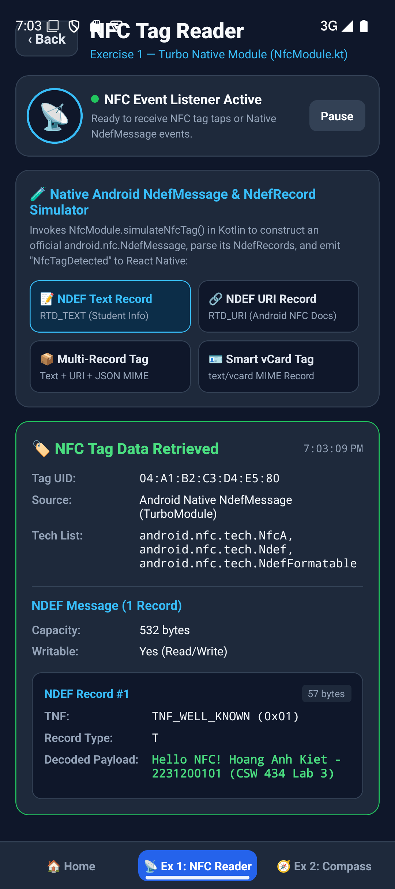
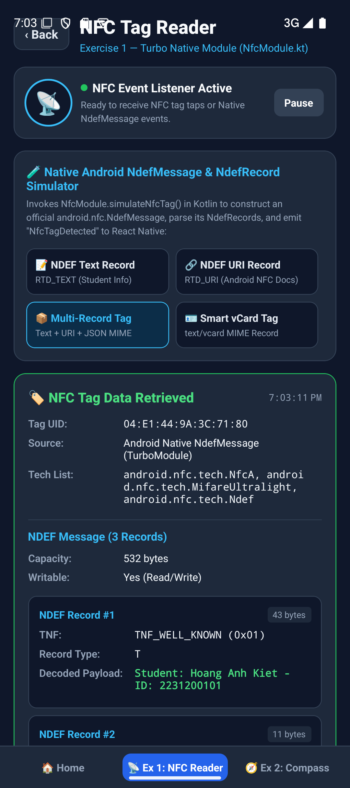
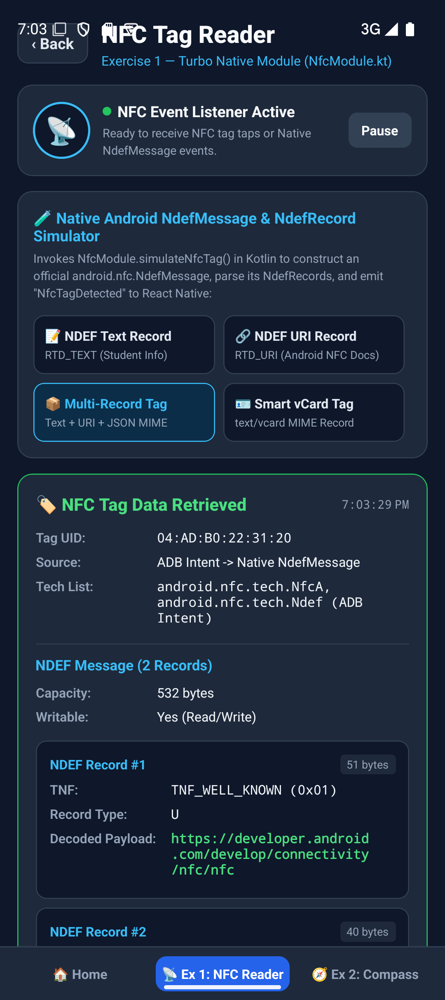
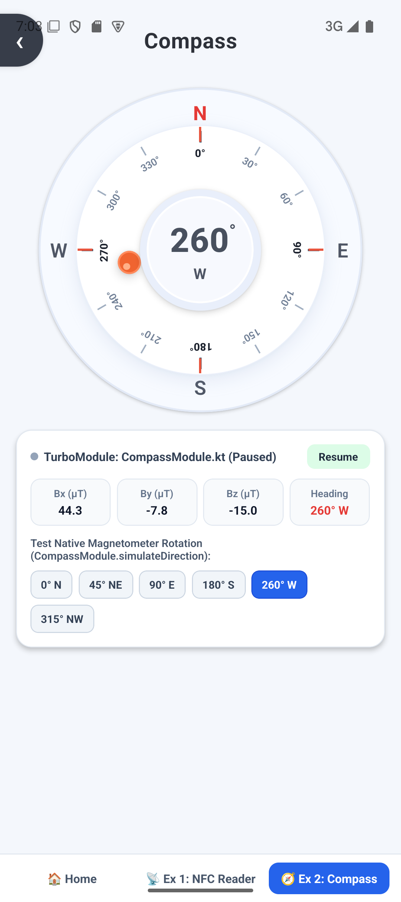
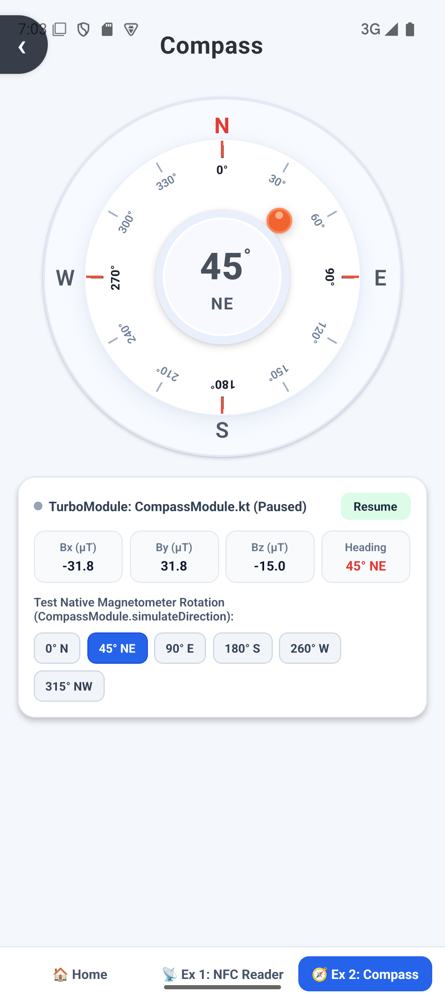

# CSW 434 — Practice Assignment 3: Using Sensors in React Native with Turbo Modules

- **Student's Full Name:** Hoàng Anh Kiệt
- **Student ID:** `2231200101`
- **Course:** CSW 434 — Advanced Mobile Programming
- **University:** Eastern International University (EIU)

---

## 1. Objectives & Overview

1. **Exercise 1 — Using NFC to Read Data from an NFC Tag:**
   - Custom Android Kotlin Turbo Native Module (`NfcModule.kt` + `NativeNfcModule.ts`) using `NfcAdapter`, `Ndef`, `NdefMessage`, and `NdefRecord` without third-party libraries (`react-native-nfc-manager`).
   - Automatically registers the `NfcTagDetected` event listener when the app starts.
   - Supports physical NFC tags, ADB `NDEF_DISCOVERED` intent injection, and native `android.nfc.NdefMessage` simulation on Android Emulator.

2. **Exercise 2 — Using a Compass to Determine Direction (Screen 1):**
   - Custom Android Kotlin Turbo Native Module (`CompassModule.kt` + `NativeCompassModule.ts`) using `SensorManager`, `Sensor.TYPE_MAGNETIC_FIELD`, and `Sensor.TYPE_ACCELEROMETER` without third-party libraries (`expo-sensors`).
   - Computes azimuth angle (`0°–360°`) relative to magnetic North via `SensorManager.getRotationMatrix()` & `SensorManager.getOrientation()`.
   - Recreates the **Screen 1** neumorphic compass UI with a dynamically rotating indicator needle and live magnetometer telemetry (`Bx, By, Bz` in `μT`).

---

## 2. Emulator Verification Screenshots

| Home Screen | Exercise 1: NDEF Text Record | Exercise 1: Multi-Record Tag |
| :---: | :---: | :---: |
|  |  |  |

| Exercise 1: ADB NDEF Intent | Exercise 2: Compass 260° (Screen 1) | Exercise 2: Compass 45° NE |
| :---: | :---: | :---: |
|  |  |  |

---

## 3. Project Structure

```text
CSW434_Lab3_HoangAnhKiet_2231200101/
├── screenshots/                         # Emulator verification screenshots
└── Lab3Sensors/
    ├── App.tsx                          # Home screen & exercise navigation
    ├── src/
    │   ├── specs/
    │   │   ├── NativeNfcModule.ts       # TurboModule spec for NfcModule
    │   │   └── NativeCompassModule.ts   # TurboModule spec for CompassModule
    │   └── screens/
    │       ├── NfcScreen.tsx            # Exercise 1: NFC Tag Reader UI
    │       └── CompassScreen.tsx        # Exercise 2: Screen 1 Neumorphic Compass UI
    └── android/app/src/main/
        ├── AndroidManifest.xml          # NFC permissions & NDEF_DISCOVERED intent filters
        └── java/com/lab3sensors/
            ├── MainActivity.kt          # NFC foreground dispatch & onNewIntent routing
            ├── MainApplication.kt       # Registers SensorsPackage with ReactHost
            ├── SensorsPackage.kt        # ReactPackage providing NfcModule & CompassModule
            ├── NfcModule.kt             # Kotlin Turbo Native Module for NFC & NDEF parsing
            └── CompassModule.kt         # Kotlin Turbo Native Module for Magnetometer Compass
```

---

## 4. How to Run

```bash
cd Lab3Sensors
npm install
npm run android
```

### Testing NFC via ADB on Android Emulator

```bash
adb shell am start \
  -a android.nfc.action.NDEF_DISCOVERED \
  -d "https://developer.android.com/develop/connectivity/nfc/nfc" \
  --es mock_payload "Hoang_Anh_Kiet_2231200101_CSW434_Lab3" \
  -n com.lab3sensors/.MainActivity
```
